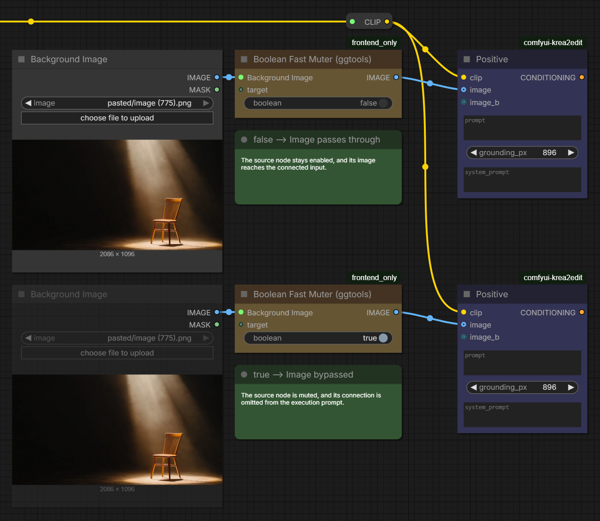

<p align="center">
  
</p>

# GGTools for ComfyUI

Practical custom nodes for controlling ComfyUI workflows. Currently includes **Boolean Fast Muter (ggtools)**: enable or mute upstream nodes using a connectable Boolean toggle.

## Boolean Fast Muter (ggtools)

An image when you need it, no connection when you don't. Use the local Boolean toggle or its input socket to control the image source. The receiving node must support an optional image input. The toggle means **bypass**: `true` skips the image, `false` lets it through. New nodes default to `false`.

| Control | Result |
| --- | --- |
| `true` | Bypass is active: the controlled image connection is omitted. |
| `false` | No bypass: the image passes through from the first connected target. |



**Top — `false`:** the Background Image node stays enabled and supplies the image. **Bottom — `true`:** the source node is visibly muted, and its connection is omitted from the queued prompt.

Outside subgraphs, target nodes update while you edit the workflow, within about 100 ms. Inside subgraphs, routing is resolved separately for each instance when the prompt is serialized. The output follows the target's type, including when connected to **Any Switch (rgthree)**. An unresolved target stays generic.

Targets can also carry masks, latents, conditioning, models, CLIP, VAE, audio, or scalar values. Routing preserves the source output socket; `OPT_CONNECTION` forwards only the first connected target. Additional targets share the same Boolean control.

### How It Solves Optional Input Validation

Returning `None` from an image source still leaves its connection in the execution prompt. A switch may also require both branches to be connected, depending on its input definitions. Neither approach necessarily gives the receiving node the same behavior as an unconnected optional input.

**Boolean Fast Muter (ggtools)** changes which connections ComfyUI includes when serializing the prompt:

- **When `true`:** Bypass is active: the target is muted, and its connection is omitted from the execution payload. The receiving node sees an absent optional input, rather than a connected source returning `None`.
- **When `false`:** Bypass is inactive: the target is enabled, and its connection is included again, routing the image without manually reconnecting the workflow.

This lets a workflow supply an image only when needed, without placeholder images or repeated rewiring. The receiving input must be optional; required inputs still produce `Required input is missing` when their connection is omitted.

## Install

Clone into your ComfyUI `custom_nodes` directory using a GitHub account with access to this private repository:

```sh
cd /path/to/ComfyUI/custom_nodes
git clone https://github.com/xducer/comfyui-ggtools.git
```

Restart ComfyUI and refresh the browser. No extra Python packages or `pip install` step are needed.

## Connect

1. Add **Boolean Fast Muter (ggtools)** from `ggtools`.
2. Connect the output of the node you want to control to a `target` socket. A spare socket appears for additional targets.
3. Use the `boolean` toggle or connect a boolean node to its input socket.
4. Connect `OPT_CONNECTION` to the optional image input or a compatible switch. You can also keep the source connected directly to its destination.

Disconnecting the external Boolean returns control to the local toggle. Multiple targets share the same Boolean; the optional output resolves through the first connected target.

### Controlling Subgraph Inputs from the Outside

Expose the Boolean toggle on the parent subgraph node to control optional images from the main canvas:

1. Place **Boolean Fast Muter (ggtools)** inside the subgraph.
2. Connect the incoming subgraph image to `target`, then connect `OPT_CONNECTION` to each optional image input you want to control.
3. Add a Boolean input to the subgraph, for example **Bypass image BG ?**, and wire it to the muter’s `boolean` socket. The parent subgraph node exposes the toggle.
4. Toggle it from the main canvas: `true` bypasses the image connection; `false` includes it when queuing.

The image must pass through the muter’s output; connecting only the Boolean does not control an image path. Incoming images are gated within that subgraph instance, so other uses of the parent image stay connected. Multiple instances of the same subgraph can use different toggle values.

### Supported use

- Works as a standalone frontend extension; rgthree is not required to use the node.
- The local toggle, built-in Boolean constants, Boolean primitives, and exposed parent subgraph toggles are supported. Values calculated during execution are not supported.
- A parent subgraph Boolean toggle and incoming image can feed the muter through the subgraph’s input slots.
- Target connections can pass through reroutes and rgthree Node Collectors or Node Combiners; their upstream nodes are controlled together.
- Targeting a nested subgraph also suppresses its descendants, including output nodes, within that instance. Disabling the outer bypass preserves inner controls.
- Outside subgraphs, muting a source affects all its outputs. Each muter still closes its own output when its Boolean is `true`, even if another controller enables the source.
- A required socket still needs a value. Widget-backed scalar inputs may use their local value when a connected source is bypassed.
- Already queued prompts are unaffected. API-only submissions do not run this frontend node.

## Update

```sh
cd /path/to/ComfyUI/custom_nodes/comfyui-ggtools
git pull --ff-only
```

Restart ComfyUI and refresh the browser after updating.

<details>
<summary>Implementation details</summary>

The pack registers its frontend files through `__init__.py`. Node behavior lives in `web/boolean_fast_muter.js`; Python runtime dependencies are empty in `pyproject.toml`, so there is no `requirements.txt`.

</details>

## Credits

Inspired by [Fast Muter from rgthree-comfy](https://github.com/rgthree/rgthree-comfy).
