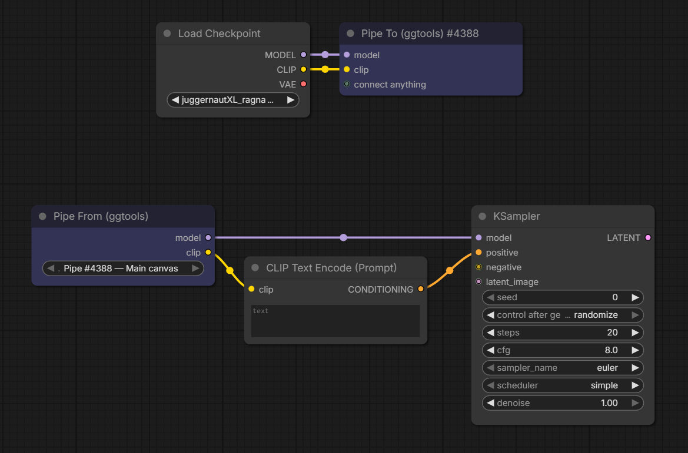
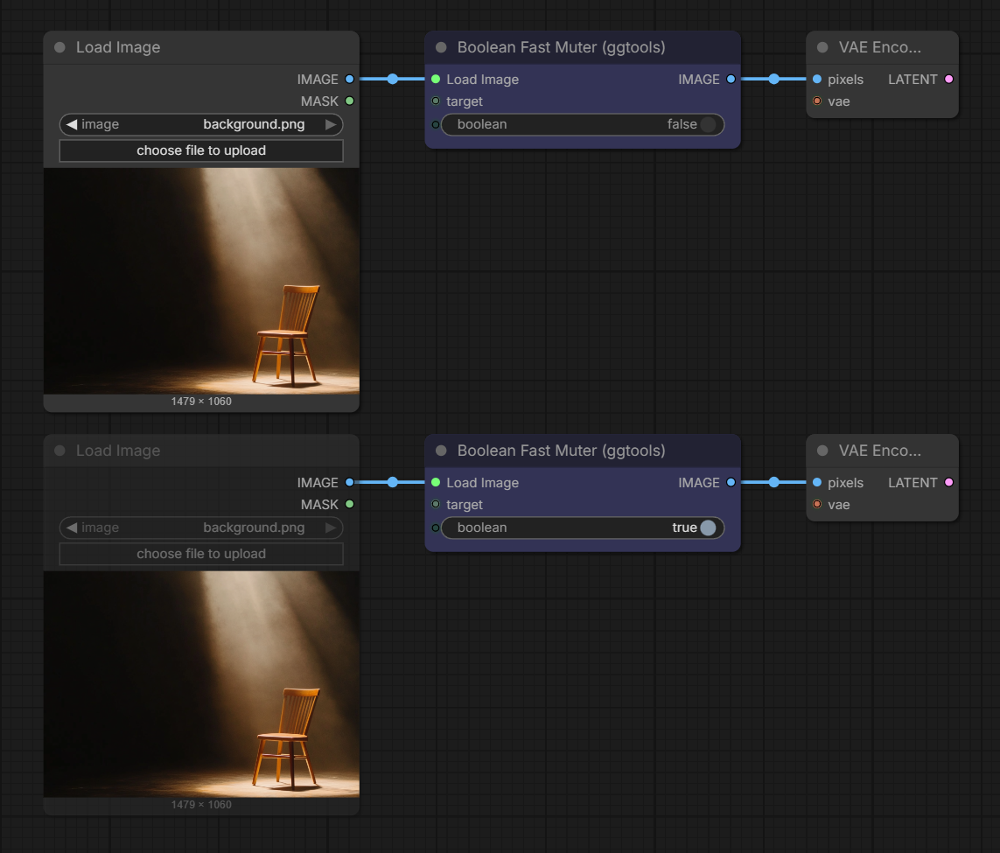
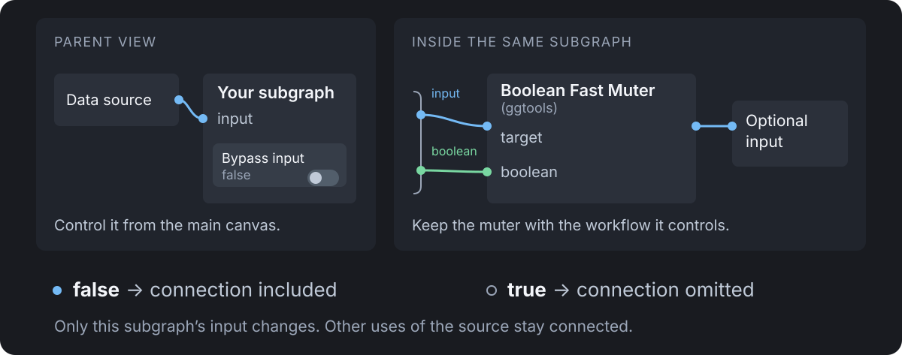

# GG Tools for ComfyUI

Frontend-only nodes for keeping large ComfyUI workflows tidy, switchable and easy to compare. No Python packages or extra requirements.

| Node | What it does |
| --- | --- |
| **Pipe To / Pipe From (ggtools)** | Send connections anywhere in the workflow, including into and out of subgraphs, without wires. |
| **LoRA Multi-Stack (ggtools)** | Several LoRA stacks side by side from one LoRA list, each with its own model and clip outputs, for comparing LoRA combinations. |
| **Boolean Fast Muter (ggtools)** | Switch a connection, or a group of source nodes, on and off with a Boolean. |

All four are under **Add Node → ggtools**.

## Pipe To and Pipe From



1. Connect anything to **Pipe To (ggtools)**. Each connection becomes a named entry, and a spare `connect anything` input appears for the next one.
2. Add **Pipe From (ggtools)** anywhere, on the main canvas or inside a subgraph, and pick the Pipe To in its `pipe` dropdown, for example `Pipe #12 — Main canvas`.
3. Connect the outputs you need.

Entries are named automatically, and renames show up straight away:

| Source | Entry name |
| --- | --- |
| A named output, such as Get Image Size | `width`, `height` |
| A KJNodes Get or Set node | its variable, such as `Image_BG` |
| A source that also feeds another node's input or a Set node, when those names agree | that input's name or the Set variable, such as `positive` or `Clip_Base` |
| Anything else | the type, such as `model`, `clip`, then `model_2` for a second one |

A renamed node always wins: your title leads and the source's own name follows in brackets, unless the title already contains it: `Background size [width]`, `Base CLIP [Clip_Base]`, `Encode Load Image [latent]`. Renaming an output slot or a subgraph input names the value directly.

![Load Checkpoint and a LoRA node renamed Detail Lora both feed Pipe To, which shows model, Detail Lora [model] and Detail Lora [clip]. The Pipe From sends model to one Basic Guider and Detail Lora [model] to another.](assets/pipes_example_02.png)

Same-type values stay apart by name, so each one goes exactly where you connect it.

- Any connection type works, and several Pipe To and Pipe From nodes can share a workflow. A new Pipe From selects the Pipe To automatically when there is only one.
- Inside a subgraph, **This instance** reads the Pipe To in the same copy of the subgraph, so each copy of a reused subgraph sends its own values.
- Pipes keep working through copy and paste, cut and paste, Convert to Subgraph and unpacking. A Pipe To copied together with its Pipe From becomes a new, independent pair.
- Switching a Pipe From to another pipe keeps the connections whose name and type exist on the new pipe. Anything else, including an entry removed from the Pipe To, is marked `(missing)` rather than silently fed a different value. If the selected pipe itself is gone, the dropdown shows `Missing: …`; a pasted Pipe From that can't tell which copy of a pipe it belongs to asks you to `Select copied pipe source`.

When you queue, each used output becomes an ordinary link to the original source, and the pipe nodes never reach the server. Unused outputs are ignored. If a muted or bypassed source leaves an entry empty, the receiving input is left unconnected, as if it were wired directly. Queuing stops with an error naming the Pipe From if a used output is `(missing)`, its pipe was deleted, or no pipe is selected.

## LoRA Multi-Stack


Each column is a **group**: its own LoRA stack, with its own `model` and `clip` outputs on the bottom edge under it. Each row is a LoRA, and each cell is that LoRA's strength in that group. Connect `model`, and `clip` if your LoRAs need it; the clip outputs appear once `clip` is connected.

| Where | Click | Double-click | Right-click |
| --- | --- | --- | --- |
| Strength cell | on/off (keeps the value) | type a value | |
| Group name | bypass: the group's outputs pass model and clip through unchanged | rename | rename, bypass, duplicate, remove |
| LoRA name | mute in every group | pick a LoRA (with a filter box) | change, mute, remove |

- Drag a strength left or right to adjust it. `0.80` sets model and clip; tick **clip strengths** to set them separately (stored as `0.80/0.50`). An empty cell, an off cell or `0` leaves the LoRA out of that group.
- **+** adds a group copying the last one; **+ LoRA** adds a row. Removing a group or row can be undone from the footer until your next edit.
- Dots after a group name show which of its outputs are wired; a ring means the matching input isn't connected.
- Hover anything for a short explanation above the table.


The title-bar button switches to **compact view**: a normal node with each group's outputs listed on the right. Switch back with the same button. Toggling bypass in compact view is in the node's right-click menu.

When you queue, each used group becomes a chain of ComfyUI's own LoRA loaders, and the node never reaches the server. Groups that start with the same LoRAs at the same strengths load that part once.

## Boolean Fast Muter



Connect a source node's output to `target`, then connect `OPT_CONNECTION` to the input it should feed. Once connected, the sockets show the source's name and type instead.

| `boolean` | Result |
| --- | --- |
| `false` (default) | The source runs and its output passes through. |
| `true` | The source is muted and the connection is left out of the queued prompt. |

- Use the toggle on the node, or connect a core Boolean, Primitive or Easy-Use boolean node. Other Boolean sources, including values calculated during execution, stop the queue with an error.
- Connect several targets to switch them together. `OPT_CONNECTION` forwards the first connected target. Targets can sit behind reroutes or rgthree Node Collector / Node Combiner nodes.
- Several muters can control the same node; it stays muted while any of them is `true`. A muter can also target another muter: `true` mutes that muter and cuts its output.
- While a muter is `false`, its targets are kept enabled. Inside a subgraph, targets are muted only in the queued prompt, separately for each copy of the subgraph, and don't look muted on the canvas.
- Disconnecting a target, deleting the muter or bypassing it re-enables what it muted.
- A left-out connection is simply absent, not `None`. The muter can't make an input optional, so what happens next depends on the receiving node:
  - **Widget input** (a value you can also type in): falls back to its widget value.
  - **Optional input the node really supports leaving empty**: the node runs without it.
  - **Required input**: fails with `Required input is missing`.
  - **Optional input the node doesn't really support**: the node may raise its own error, or pass `None` on, so the next node fails instead. ComfyUI's Switch node does this when the selected input is missing.

  Place the muter right before a node that is built to run without that input, and test the `true` case once. Nodes reading the muted source directly, not through `OPT_CONNECTION`, also receive nothing.

  **For an input that needs a value**, use ComfyUI's **Switch** node instead: `on_false` = your source, `on_true` = a stand-in (for example an empty latent or a blank image) and the same Boolean on `switch`. Its inputs are lazy, so the branch it doesn't select isn't computed.

### Controlling a subgraph from outside



Put the muter inside the subgraph with its targets, and drag its `boolean` socket onto the subgraph's input slot to create a Boolean subgraph input. The toggle then appears on the parent subgraph node, and each copy of the subgraph can have its own value. Use one muter per subgraph input you want to switch independently.

## Install

Search for **GG Tools** in ComfyUI Manager, or clone it:

```sh
cd /path/to/ComfyUI/custom_nodes
git clone https://github.com/xducer/comfyui-gg-tools.git
```

Restart ComfyUI and refresh the browser. To update, run `git pull --ff-only` in `custom_nodes/comfyui-gg-tools`, then restart and refresh. Tested with ComfyUI 0.37 and frontend 1.53; the nodes rely on the subgraph features of recent frontends.

Workflows that use these nodes need the pack installed to open; exported API prompts don't.

## Notes

- The nodes work in the browser; the queued prompt contains only ordinary nodes and links. **Export (API)** includes their effect, but an exported prompt does not change if you toggle afterwards, and prompts already queued are unaffected.
- Boolean Fast Muter is inspired by [Fast Muter from rgthree-comfy](https://github.com/rgthree/rgthree-comfy).

## License

Apache-2.0, see [LICENSE](LICENSE).
