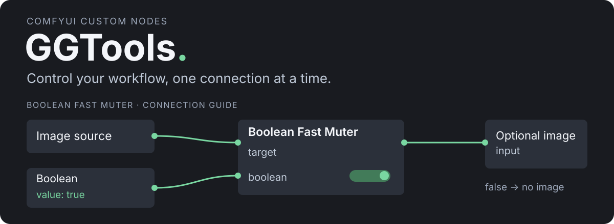

<p align="center">
  
</p>

# GGTools for ComfyUI

Practical custom nodes for controlling ComfyUI workflows. Currently includes **Boolean Fast Muter**: enable or mute upstream nodes using a connectable Boolean toggle.

## Boolean Fast Muter

An image when you need it, no connection when you don't. Use the local Boolean toggle or its input socket to control the image source. The receiving node must support an optional image input.

| Control | Result |
| --- | --- |
| `true` | Target nodes are enabled; the output resolves to the first connected target. |
| `false` | Target nodes are muted; their connections are omitted from the execution prompt. |

Target nodes update while you edit the workflow, within about 100 ms. The output follows the target's type, including when connected to **Any Switch (rgthree)**. An unresolved target stays generic.

### How It Solves Optional Input Validation

Returning `None` from an image source still leaves its connection in the execution prompt. A switch may also require both branches to be connected, depending on its input definitions. Neither approach necessarily gives the receiving node the same behavior as an unconnected optional input.

**Boolean Fast Muter** changes which connections ComfyUI includes when serializing the prompt:

- **When `false`:** The target is muted, and its connection is omitted from the execution payload. The receiving node sees an absent optional input, rather than a connected source returning `None`.
- **When `true`:** The target is enabled, and its connection is included again, routing the image without manually reconnecting the workflow.

This lets a workflow supply an image only when needed, without placeholder images or repeated rewiring. The receiving input must be optional; required inputs still produce `Required input is missing` when their connection is omitted.

## Install

Clone into your ComfyUI `custom_nodes` directory using a GitHub account with access to this private repository:

```sh
cd /path/to/ComfyUI/custom_nodes
git clone https://github.com/xducer/comfyui-ggtools.git
```

Restart ComfyUI and refresh the browser. No extra Python packages or `pip install` step are needed.

## Connect

1. Add **Boolean Fast Muter** from `ggtools`.
2. Connect the output of the node you want to control to a `target` socket. A spare socket appears for additional targets.
3. Use the `boolean` toggle or connect a boolean node to its input socket.
4. Connect `OPT_CONNECTION` to the optional image input or a compatible switch. You can also keep the source connected directly to its destination.

Disconnecting the external Boolean returns control to the local toggle. Multiple targets share the same Boolean; the optional output resolves through the first connected target.

### Supported use

- Works as a standalone frontend extension; rgthree is not required to use the node.
- Control values must be available before execution; booleans calculated during execution are not supported.
- Keep the Boolean and its targets in the same graph.
- Muting does not make a required destination input optional.
- Already queued prompts are unaffected. API-only submissions do not run this frontend node.

## Update

```sh
cd /path/to/ComfyUI/custom_nodes/comfyui-ggtools
git pull --ff-only
```

Restart ComfyUI and refresh the browser after updating.

<details>
<summary>Development and verification</summary>

The pack registers its frontend files through `__init__.py`. Node behavior lives in `web/boolean_fast_muter.js`; Python runtime dependencies are empty in `pyproject.toml`, so there is no `requirements.txt`.

Run these checks from the **ComfyUI root**, with Node.js 24 or later:

```sh
node custom_nodes/comfyui-ggtools/tests/muter.test.mjs
node custom_nodes/comfyui-ggtools/tests/frontend.integration.mjs
```

The behavior tests include rgthree's installed type-inference helper, so that test suite expects a sibling `custom_nodes/rgthree-comfy` checkout. The integration check reads source maps from the installed ComfyUI frontend package in the root's `venv` directory and exercises its actual serializer and virtual-node resolver.

The node has also been tested interactively by the repository owner, including Boolean control, image output, and live muting.

</details>

## Credits

Inspired by [Fast Muter from rgthree-comfy](https://github.com/rgthree/rgthree-comfy). GGTools installs separately so updates to other node packs do not overwrite it.
