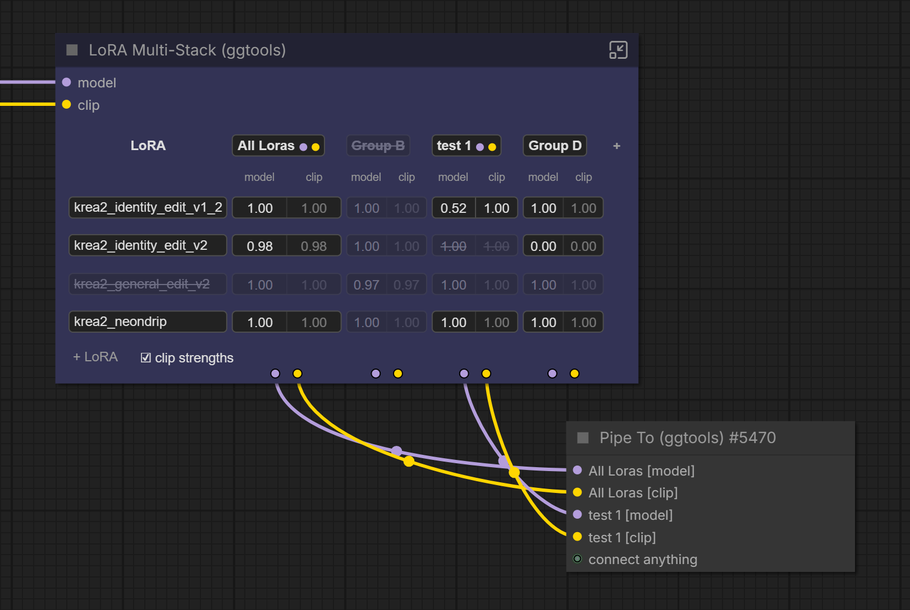
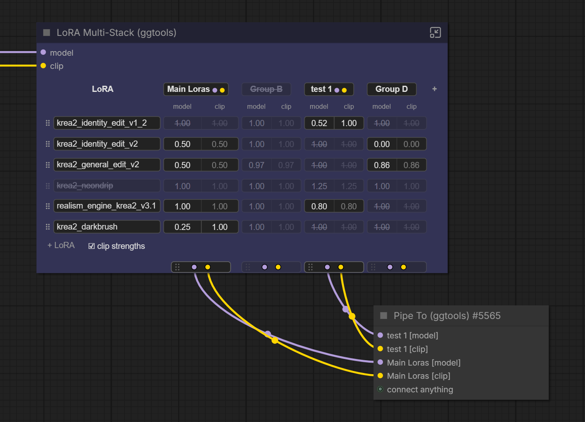
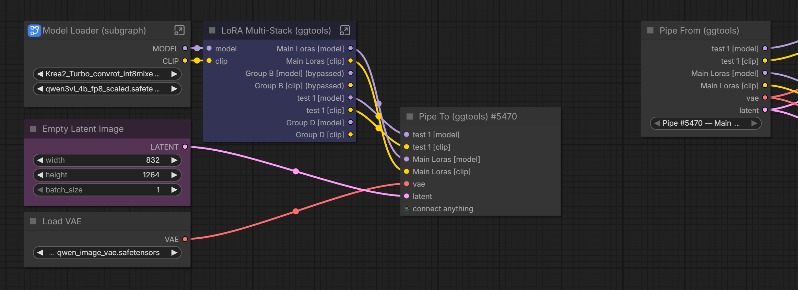
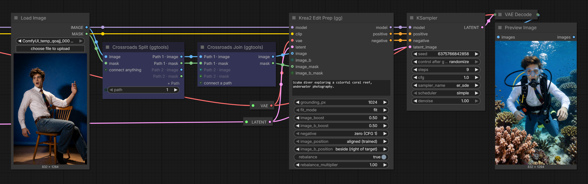
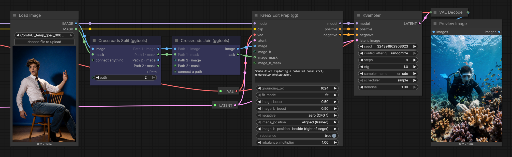

# GG Tools for ComfyUI

Frontend-only nodes for keeping large ComfyUI workflows tidy, switchable and easy to compare. No Python packages or extra requirements.

| Node | What it does |
| --- | --- |
| **Pipe To / Pipe From (ggtools)** | Send connections anywhere in the workflow, including into and out of subgraphs, without wires. |
| **LoRA Multi-Stack (ggtools)** | Several LoRA stacks side by side from one LoRA list, each with its own model and clip outputs, for comparing LoRA combinations. |
| **Crossroads Split / Join (ggtools)** | Choose by number which of several paths runs; the other paths are left out of the queue. Also switches optional inputs off. |

All five are under **Add Node → ggtools**.

## Pipe To and Pipe From


1. Connect anything to **Pipe To (ggtools)**. Each connection becomes a named entry, and a spare `connect anything` input appears for the next one.
2. Add **Pipe From (ggtools)** anywhere, on the main canvas or inside a subgraph, and pick the Pipe To in its `pipe` dropdown, for example `Pipe #12 — Main canvas`.
3. Connect the outputs you need.

Entries are named automatically, and renames show up straight away:

| Source | Entry name |
| --- | --- |
| A named output, such as Get Image Size | `width`, `height` |
| A KJNodes Get or Set node | its variable, such as `Image_BG` |
| A source that also feeds another node's input or a Set node, when those names agree | that input's name or the Set variable, such as `positive` or `Clip_Base` |
| Anything else | the type, such as `model`, `clip`, then `model_2` for a second one |

A renamed node always wins: your title leads and the source's own name follows in brackets, unless the title already contains it: `Background size [width]`, `Base CLIP [Clip_Base]`, `Encode Load Image [latent]`. Renaming an output slot or a subgraph input names the value directly.

![Load Checkpoint and a LoRA node renamed Detail Lora both feed Pipe To, which shows model, Detail Lora [model] and Detail Lora [clip]. The Pipe From sends model to one Basic Guider and Detail Lora [model] to another.](assets/pipes_example_02.png)

Same-type values stay apart by name, so each one goes exactly where you connect it.

- Any connection type works, and several Pipe To and Pipe From nodes can share a workflow. A new Pipe From selects the Pipe To automatically when there is only one.
- Inside a subgraph, **This instance** reads the Pipe To in the same copy of the subgraph, so each copy of a reused subgraph sends its own values.
- Pipes keep working through copy and paste, cut and paste, Convert to Subgraph and unpacking. A Pipe To copied together with its Pipe From becomes a new, independent pair.
- Switching a Pipe From to another pipe keeps the connections whose name and type exist on the new pipe. Anything else, including an entry removed from the Pipe To, is marked `(missing)` rather than silently fed a different value. If the selected pipe itself is gone, the dropdown shows `Missing: …`; a pasted Pipe From that can't tell which copy of a pipe it belongs to asks you to `Select copied pipe source`.

When you queue, each used output becomes an ordinary link to the original source, and the pipe nodes never reach the server. Unused outputs are ignored. If a muted or bypassed source leaves an entry empty, the receiving input is left unconnected, as if it were wired directly. Queuing stops with an error naming the Pipe From if a used output is `(missing)`, its pipe was deleted, or no pipe is selected.

## LoRA Multi-Stack



Each column is a **group**: its own LoRA stack, with its own `model` and `clip` outputs on the bottom edge under it. Each row is a LoRA, and each cell is that LoRA's strength in that group. Connect `model`, and `clip` if your LoRAs need it; the clip outputs appear once `clip` is connected.


| Where | Click | Double-click | Right-click |
| --- | --- | --- | --- |
| Strength cell | on/off (keeps the value) | type a value | |
| Group name | bypass: the group's outputs pass model and clip through unchanged | rename | rename, bypass, duplicate, remove |
| LoRA name | mute in every group | pick a LoRA (with a filter box) | change, mute, remove |

- Drag a strength left or right to adjust it. `0.80` sets model and clip; tick **clip strengths** to set them separately (stored as `0.80/0.50`). An empty cell, an off cell or `0` leaves the LoRA out of that group.
- **+** adds a group copying the last one; **+ LoRA** adds a row. Drag a row's ⠿ grip up or down to reorder the LoRAs; each group applies them top to bottom. Removing a group or row can be undone from the footer until your next edit.
- Dots after a group name show which of its outputs are wired; a ring means the matching input isn't connected.
- Drag a group's socket plate onto another group to swap their model/clip wires (or move them, if that group has none). Undo in the footer reverts it.
- Hover anything for a short explanation above the table.



The title-bar button switches to **compact view**: a normal node with each group's outputs listed on the right. Switch back with the same button. Toggling bypass in compact view is in the node's right-click menu.



When you queue, each used group becomes a chain of ComfyUI's own LoRA loaders, and the node never reaches the server. Groups that start with the same LoRAs at the same strengths load that part once.

## Crossroads Split and Join


The Split sends what you connect down several numbered paths, and `path` picks the one that runs. Everything after the Split's other outputs is left out of the queued prompt, previews and saves included. The Join brings the paths back together.

1. Connect what the paths need to **Crossroads Split (ggtools)**. Each connection adds an output per path, such as `Path 1 · clip` and `Path 2 · clip`, and a spare `connect anything` appears for the next. For a number or text, use an Int, Float, String or Boolean node; the old Primitive only feeds `path`.
2. Build each path from its outputs with ordinary nodes.
3. Drop each path's result on the `connect a path` input of **Crossroads Join (ggtools)**. The Join files it under its path, in a row for its value, and gives each row an output that carries what the selected path delivers.
4. Set `path` to the number of the path to run.

| Control | What it does |
| --- | --- |
| `path` | The path that runs. Wire an Int, a Primitive or a subgraph input into it to choose from elsewhere. Numbers wrap around, so an Int set to increment after each run goes through the paths in turn. An Int set to change *after* generating shows the number for the next run; ComfyUI's widget control mode setting *before* shows the current one. |
| **+ Path** | Adds a path (also in the node's right-click menu, with Remove path). |
| **×** beside an output | Removes that path (hover the output to see it). The paths after it move up a number. |

- Paths that aren't selected are dimmed on both nodes.
- A path can change what it carries, such as clip in and conditioning back, and doesn't have to start at the Split: drop a wire from elsewhere on that path's row of the Join. Only what comes from the Split is left out, so a preview on such a path still runs.
- A node wired straight from a Split output belongs to that path. To switch only an input, bring it back through a Join.
- Crossroads can be nested. A crossroads on a path that isn't selected doesn't run at all.

### Switching an input off



A path with nothing wired into the Join passes nothing on, and the receiving input is left out of the queued prompt. Here path 1 brings the reference image and mask, and path 2 is empty:



With path 2, Krea2 Edit Prep runs without a reference, and Load Image doesn't run either. This works for inputs a node can run without. If a required input would be left empty, queuing stops, ComfyUI marks the input and a message names the path that delivers nothing.

### Controlling a subgraph from outside

Put the Split inside the subgraph and drag its `path` socket onto the subgraph's input slot. The number then appears on the parent subgraph node, and each copy of the subgraph can pick its own path. A value that enters the Split through a subgraph input takes that input's name; rename the input to rename the value.

When you queue, the Split and Join are compiled out: the selected path is wired straight through and the other paths are removed. The path number must be known when you queue; a number computed by another node stops the queue with an error.

## Install

Search for **GG Tools** in ComfyUI Manager, or clone it:

```sh
cd /path/to/ComfyUI/custom_nodes
git clone https://github.com/xducer/comfyui-gg-tools.git
```

Restart ComfyUI and refresh the browser. To update, run `git pull --ff-only` in `custom_nodes/comfyui-gg-tools`, then restart and refresh. Tested with ComfyUI 0.37 and frontend 1.53; the nodes rely on the subgraph features of recent frontends.

Workflows that use these nodes need the pack installed to open; exported API prompts don't.

## Notes

- The nodes work in the browser; the queued prompt contains only ordinary nodes and links. **Export (API)** includes their effect, but an exported prompt does not change if you change the nodes afterwards, and prompts already queued are unaffected.

## License

Apache-2.0, see [LICENSE](LICENSE).
